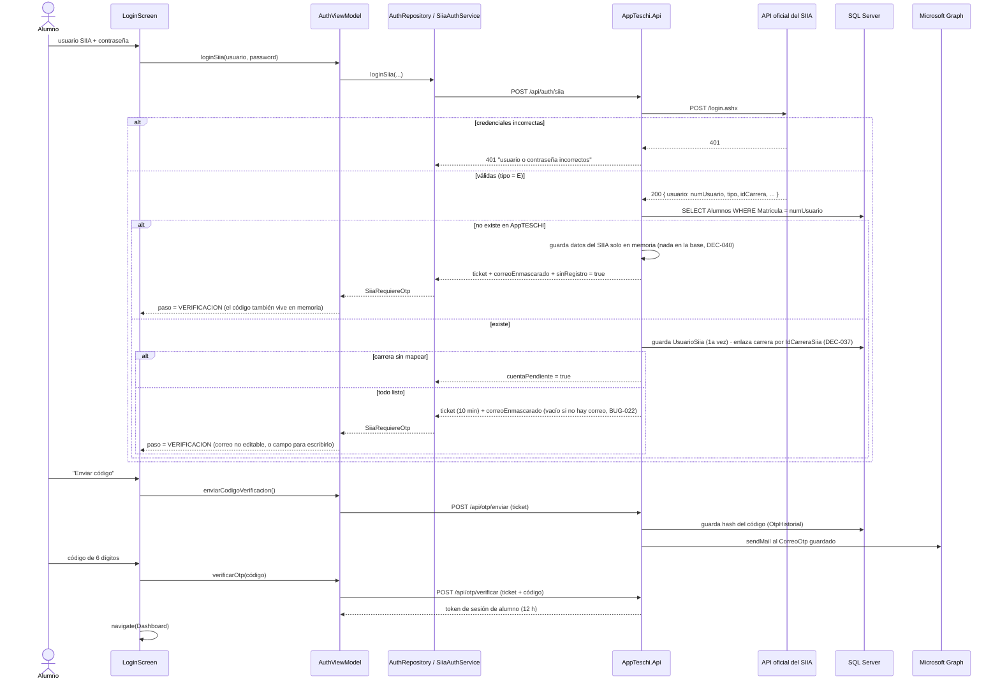
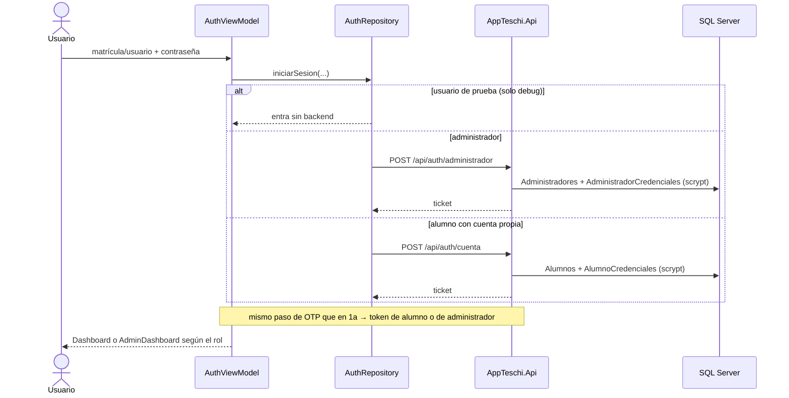
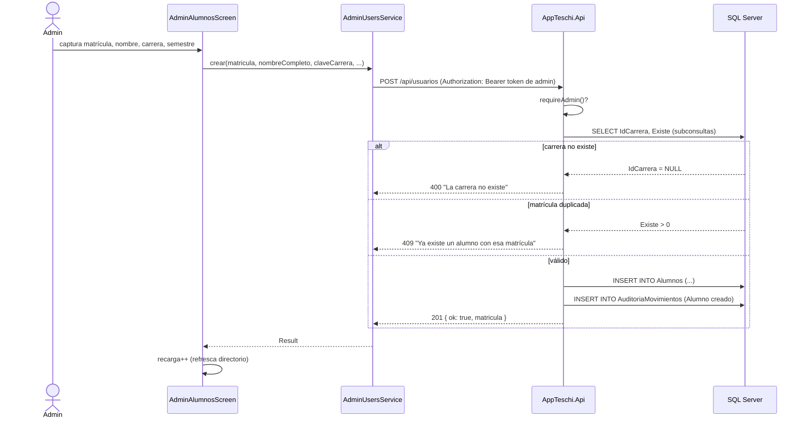
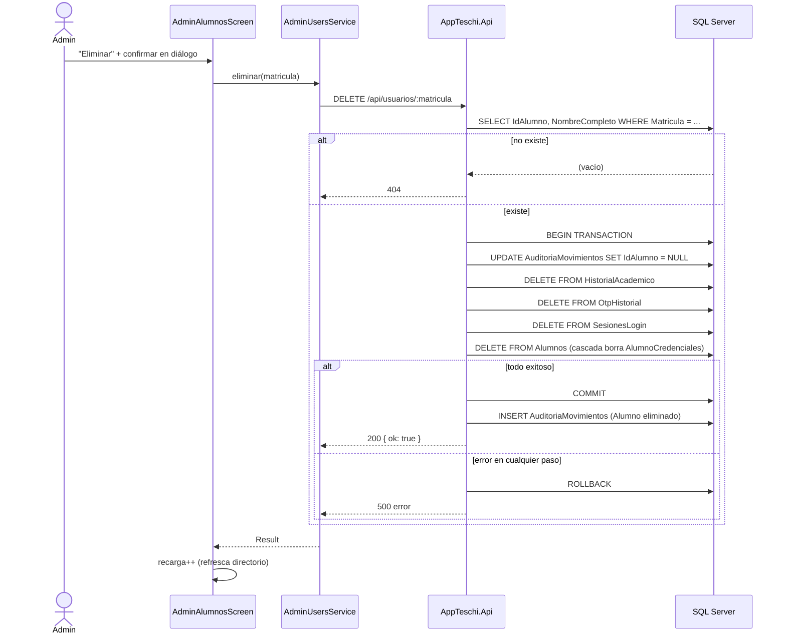
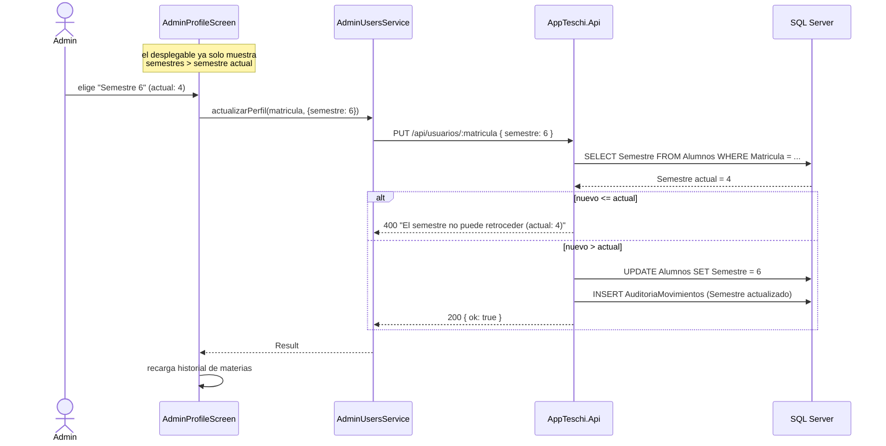
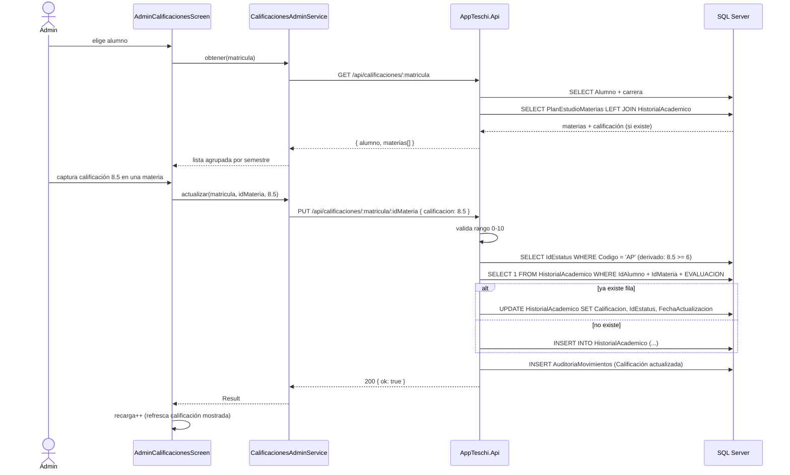

# Diagramas de Secuencia — AppTESCHI

> ⚠️ **Desactualizado (12/10/2026, DEC-043):** describe el sistema con backend propio, base de datos y panel de administrador. Hoy la app solo tiene las pantallas del alumno con datos del SIIA (ver [[REGLAS_PROYECTO]] y [[MAPA_PROYECTO]]). Actualizar antes de entregarlo.

> Interacción temporal entre componentes para los flujos más críticos del sistema.
> **Relacionado con:** [[01_Casos_de_Uso]], [[04_Diagrama_Componentes]]

---

## 1. Iniciar sesión (ticket + OTP en el servidor) — CU-01

> Actualizado 27/09/2026. El diagrama anterior mostraba el scraping del SIIA y el OTP generado en el teléfono; ambos se retiraron (DEC-019, DEC-026). Hoy el SIIA se consulta desde el servidor con su API oficial (DEC-035).

### 1a. Paso SIIA de la cascada (cuando la cuenta de AppTESCHI no coincide)

### 1b. Cuenta de AppTESCHI (administrador o cuenta propia) — primeros pasos de la cascada

---

## 2. Registrar alumno (administrador) — CU-08

---

## 3. Eliminar alumno (transacción con limpieza en cascada) — CU-11

---

## 4. Avanzar semestre (regla "nunca retrocede") — CU-14

---

## 5. Capturar calificación — CU-15

